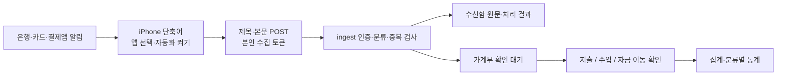

> 11/02 후속 갱신: 최신 단축어 작업은 `SHORTCUT_REVIEW_2026-11-02.md`와 README를 우선합니다. 아래 초기 검토의 Mac 서명·파일 설치 우선 권고는 폐기했습니다. iCloud 트리거 보존을 확인했으며 실기기 v2 재공유는 별도 확인이 필요합니다.

# HARAGURI 전체 점검 및 가계부 사용성 검토

검토일: 2026-11-02. 범위: 단축어, 가계부 집계, 알림, 데이터 흐름, 모바일·데스크톱 사용성, 설치·연동.

## 이번에 반영한 수정

- iPhone의 실사용 `하라구리 앱 알림 2`를 직접 확인했다. 자동화는 켜져 있었고 필터는 없었다. 빠져 있던 신한카드를 추가하고 기존 토스 선택도 함께 유지했다.
- 토스 알림은 결제 금액을 제목에, 결제수단·가맹점을 본문에 담는 사례가 있었다. 본문만 전송하면 금액을 읽을 수 없으므로 `title=알림의 제목`, `body=알림의 본문`, `via=ios-notification`을 전송하도록 보완했다.
- 공개 단축어 생성기도 제목·본문을 함께 전달한다. 개인 수집 토큰과 작성자의 앱 선택은 공개 파일에 포함하지 않는다. 서명 뒤 변수·동작 보존을 검증한다.
- 구버전 `하라구리 앱 알림`은 삭제하고 실사용본 `하라구리 앱 알림 2`를 유지했다. 문자 수집용 `하라구리 수집`은 다른 입력 경로다. 남은 실험본의 추가 삭제는 iPhone 사용으로 미러링이 종료되어 완료하지 못했다.
- 앱 안에서 쌓이는 소액 포인트와 가격 인하 안내는 지출로 저장하지 않는다. 원문은 수신함에 보관한다. 계좌의 실제 현금 입금·환급과 앱 포인트를 구분한다.
- `[입금]` 알림의 사용처에 ‘결제’라는 단어가 있어도 출금으로 오해하지 않는다.
- MG 체크카드 승인과 계좌 출금의 가맹점 이름을 보존해 동일 거래의 중복 판정을 보완했다. 가맹점 이름을 카드사 이름으로 잘못 제거하던 사례도 수정했다.
- 취소 내역의 가맹점·카드 근거가 맞지 않으면 같은 금액이라는 이유만으로 다른 구매를 취소 처리하지 않는다.
- 수신함 기록 실패를 성공으로 조용히 넘기지 않는다.
- ‘기타’ 하나로 섞여 보이던 상태를 원문에서 확인한 카드 종류, `카드 미등록`, `결제수단 미확인`, `분류 미확인`으로 구분한다. 등록되지 않은 카드를 임의로 만들지 않는다.
- 자금 이동을 독립 종류로 기록한다. 기록·CSV에는 남지만 지출, 수입, 일별·월별 합계, 예산, 카드 실적, 정산, 반복 지출 추천에서 제외한다.
- 홈의 최근 지출과 일정에 연결된 실제 지출도 수입·자금 이동을 제외한다.
- 예산 미설정 화면은 수입·지출 확인을 중심으로 보여 준다. 예산 설정은 작은 선택 동작으로 남겼다.
- 옅은 안내 글자·메뉴의 대비, 날짜 버튼과 알림 버튼의 접근성 이름, 차트의 키보드 접근을 보완했다.

## 데이터 흐름과 확인 기준

계정 연결 성공, 알림 본문 수신, 실제 결제 저장은 다른 단계다. 연결 테스트·빈 전달·광고 수신을 결제 자동 수집 성공으로 표시하지 않는다. 캡처 대조로 복구한 과거 거래도 실제 자동 수집과 구분한다.

주말 누락 검토에서는 수신함 원문과 가계부를 대조하고 개인 기록을 Git 제외 비공개 경로에 백업했다. 제목이 빠진 결제, 중복 승인·출금, 포인트 오등록, 실제 계좌 입금을 각각 다른 문제로 취급한다. 본인 이체 여부는 사용자 확인을 근거로 바꾸고, 수취인 이름만으로 미래 이체를 자동 제외하지 않는다.

현재 자산별 기초 잔액·증권 평가액을 관리하지 않으므로 거래 합계를 ‘총자산’이라고 표시하면 안 된다. 연동한 앱에서 오지 않은 알림과 유실된 과거 알림 전체를 복원했다고 주장할 수 없다.

## 예산 없이 쓰는 권장 방법

1. 평소에는 실제 소비 내역을 본다. 예산 입력을 필수로 요구하지 않는다.
2. 자동으로 읽은 결제는 확인 대기에서 금액·사용처·결제수단을 확인한다.
3. 내 계좌로 옮긴 돈은 `자금 이동`으로 선택한다. 같은 돈을 지출과 수입으로 두 번 기록하지 않는다.
4. 월급·용돈·외부에서 받은 돈은 `수입`이다. 출처를 모르는 입금은 바로 월급으로 추정하지 않는다.
5. 카드 승인과 계좌 출금이 함께 오면 결제는 한 번만 센다. 카드 대금 납부도 이미 기록한 소비와 중복 집계하지 않는 설계가 필요하다.
6. 앱 내부 포인트 적립은 가계부에서 제외한다. 실제 계좌로 입금된 현금성 혜택은 별도로 확인한다.
7. 주식 매도대금 전체를 생활 수입으로 더하지 않는다. 기존 투자자산이 현금으로 바뀌는 흐름과 투자 손익을 구분한다. 취득금액·수수료 등이 없으면 정확한 실현손익을 자동 계산하지 않는다.

## 다른 앱의 방식과 적용 판단

| 항목 | 공식 안내에서 확인한 방식 | HARAGURI 권장 방향 |
|---|---|---|
| 수입·지출·이체 | 뱅크샐러드는 세 종류의 카테고리를 지원한다 | 거래의 성격을 먼저 구분하고, 미확인 입금·출금의 판단을 돕는다 |
| 생활비와 자산 | 편한가계부는 수입·지출 통계와 자산·부채 화면을 구분한다 | 현재는 거래 가계부로 제공하고, 잔액 근거 없이 총자산을 계산하지 않는다 |
| 월 시작일 | 두 앱 모두 월 시작일 변경을 지원한다 | 월급일 생활비 보기와 달력 월별 통계를 함께 제공하는 방안을 권장한다 |
| 투자·저축 이체 | 편한가계부에는 선택한 자산의 이체를 지출처럼 표시하는 별도 설정이 있다 | 사용자가 확인한 본인 자금 이동은 기본적으로 소비에서 제외한다 |

참고:

- [뱅크샐러드 카테고리](https://help.banksalad.com/88)
- [뱅크샐러드 월 시작일](https://help.banksalad.com/164)
- [편한가계부 기본 화면](https://help.realbyteapps.com/hc/ko/articles/360043325533)
- [편한가계부 월·주간 시작일](https://help.realbyteapps.com/hc/ko/articles/360042989374)
- [편한가계부 이체지출 설정](https://help.realbyteapps.com/hc/ko/articles/360042889454)

## 큰 결정이 필요한 항목

### 1. 월급일 기준 조회

권장: 사용자가 지정한 고정 시작일부터 다음 시작일 전날까지를 ‘생활비 한 달’로 제공하고, 달력 월별 통계와 카드 실적 기간은 별도로 유지한다. 보너스·불규칙 입금·주식 매도대금이 들어올 때마다 기간을 초기화하지 않는다. 실제 급여일이 주말로 앞당겨져도 조회 경계가 임의로 흔들리지 않도록 고정일을 기본으로 삼는 편이 비교하기 쉽다.

필요한 결정: 월 시작일, 월급일 보기의 기본 여부, 가족 간 급여일이 다를 때의 기준. 이번 변경에서 날짜를 임의로 설정하지 않았다.

### 2. 계좌·증권을 포함한 자산 관리

출금 계좌, 입금 계좌, 기초 잔액, 평가 기준일, 투자 취득금액을 갖춰야 한다. 은행 잔액과 증권 자산을 함께 관리하면 매도는 자산 형태의 변화이며, 매도대금 전체를 신규 수입이나 자산 증가로 다시 더하면 안 된다. 현재 단계에서는 소비 가계부와 수동 수입·자금 이동 분류를 우선한다.

### 3. 입금·출금 분류의 자동화 수준

금액이 들어왔다고 모두 생활 수입은 아니다. 본인 이체, 환급, 월급, 투자 회수, 차입금을 구분해야 한다. 권장: 미확인 거래에 `수입 / 자금 이동 / 환급 / 실제 지출`을 선택하는 확인 흐름. 자동 추정을 허용할 범위와 확인 전 합계 반영 기준은 별도 결정이 필요하다.

### 4. 단축어 설치를 더 간단하게 하기

지금 가능한 간편 경로는 공개 서명 파일 추가 → 짧은 만료의 계정 연결 버튼 → 앱 선택·자동화 켜기다. 긴 수집 주소를 붙여넣는 과정을 줄였다. 현재 공개 파일은 `manual_trigger=true`, `collector_ready=false`로 표시하며 실제 폰의 최초 앱 선택·활성화가 필요하다.

실사용 iPhone의 기존 단축어를 직접 고친 것과, 신규 사용자의 설치 파일을 가져오기만 해서 완전히 동작하는 것은 구분해야 한다. 구버전 Mac 서명에서 트리거가 보존되지 않던 사실을 무시하고 ‘설치 한 번이면 완료’라고 안내하지 않는다.

Apple의 알림 트리거는 앱과 제목·부제·본문 필터를 제공한다. Wallet의 거래 트리거는 선택한 카드의 탭 거래를 대상으로 하므로 모든 은행·결제앱 알림의 대체 경로로 간주할 수 없다. Mac 중계는 Mac의 실행·연결 상태에 의존하므로 상시 수집의 기본 경로보다 보조 수단이 적절하다.

- [Apple iOS 27 자동화](https://support.apple.com/en-euro/guide/shortcuts/apdfbdbd7123/10.0/ios/27)
- [Apple 알림 트리거와 필터](https://support.apple.com/en-az/guide/shortcuts/apd932ff833f/ios)
- [Apple Wallet 거래 트리거](https://support.apple.com/en-euro/guide/shortcuts/apd65c67538a/ios)

후속 검증: 트리거를 보존한 공용 파일의 실제 신규 iPhone 설치·계정 연결·실제 결제 수신을 끝까지 확인한다. 금융 데이터 직접 연동이나 네이티브 수집 앱은 비용·권한·운영 범위가 큰 별도 결정이다.

### 5. 누락·중복에 대한 운영 기준

단축어의 오프라인 전송 대기열, 재시도, 원천 거래 식별자, OCR과 알림 간 중복 판정 강화를 검토한다. 단순히 같은 날 같은 금액이라는 이유만으로 서로 다른 결제를 합치면 안 된다. 현재 수신한 자료만으로 모든 금융 내역을 완전하게 수집했다고 표시하지 않는다.

### 6. 단축어보다 간단한 결제 내역 수집 방법

2026-11-02 공식 개발 문서와 서비스 안내를 검색했다. 현재 개인·가족 사용에는 **알림 단축어 한 번 설정 + 주기적인 카드/은행 원장 대조**가 가장 도입 부담이 작다. ‘폰 설정 없이 모든 과거 거래까지 자동 수집’이 목표라면 금융기관 조회 API 또는 제공업체와의 연동이 별도 필요하다.

| 방법 | 새 알림 | 과거 누락 대조 | 초기 설정·운영 부담 | 현재 판단 |
|---|---|---|---|---|
| iPhone 알림 단축어 | 가능 | 이미 지나간 알림 재생은 별도 | 앱 선택·최초 권한·계정 연결 | 지금의 기본 경로. 제목·본문을 함께 보내고 수신함에서 확인 |
| 캡처 OCR | 자동 알림과 별도 | 사용자가 내역을 캡처해 보충 | 카드 로그인은 사용자가 기존 앱에서 수행 | 현재 구현됨. 급한 과거 누락 보충에 사용 |
| CSV/Excel 원장 가져오기 | 정기 파일 확보 필요 | 원장에 포함된 기간 대조에 적합 | 파일 선택·열 매핑·중복 검증 | 다음 개발 후보. 현재 CSV 가져오기 기능은 구현되지 않음 |
| 개인카드·계좌 조회 제공업체 | 조회 주기에 따름 | 지원 범위 내에서 가능 | 금융기관 인증, 이용 계약·요금·지원 카드 검증 | 자동 대조가 꼭 필요할 때 비교 견적·시험 연동 결정 |
| 금융결제원 오픈뱅킹 | 계좌 거래내역 API 제공 | 기간·페이지별 계좌 조회 | 이용기관 승인·계약, 사용자 계좌 등록·OAuth | 서비스 확대 단계의 후보. 카드 승인 전체 지원은 별도 확인 |
| 직접 브라우저 스크래핑 | 예약 실행을 직접 구성 | 로그인한 사이트의 내역 범위 | 로그인·추가 인증·세션·화면 변경 대응 | 초기에는 가능해 보여도 유지 부담이 커서 기본 경로로 권장하지 않음 |

실제로 확인한 조회 서비스:

- [쿠콘 개인카드 정보 조회](https://www.coocon.net/products/api/349): 보유 카드·이용·청구 관련 조회 상품. [개인 은행계좌 조회](https://www.coocon.net/products/api/464)도 별도 안내한다. 지원 금융기관, 개인카드 인증 방식, 가격은 계약 전 확인해야 한다.
- [Octover API 목록](https://developer.octover.co.kr/apis): 개인카드의 인증서/아이디 로그인, 승인·청구 조회 등이 목록에 있다. 실제 대상 카드로 검증하거나 계약한 것은 아니다.
- [CODEF 공식 소개서](https://codef.io/assets/pdf/202308_CODEF%20API%20%EC%84%9C%EB%B9%84%EC%8A%A4%EC%86%8C%EA%B0%9C%EC%84%9C.pdf): 개인·법인 카드와 계좌 조회 상품을 소개한다. 과거 소개서이므로 현재 상품 지원·가격의 확정 근거로 사용하지 않는다.
- [금융결제원 거래내역 API](https://developers.kftc.or.kr/dev/openapi/open-banking/transaction): 등록 계좌의 핀테크이용번호와 토큰으로 거래내역을 조회한다. [OAuth 안내](https://developers.kftc.or.kr/dev/openapi/open-banking/oauth)와 [이용기관 안내](https://openapi.kftc.or.kr/service/openBanking)상 이용기관 승인·계약과 사용자 인증 흐름이 필요하다.

제품 방향 제안: 지금은 정상화한 알림 단축어를 유지하고, 과거 원장 가져오기와 중복 대조를 다음 작은 기능으로 검토한다. 실시간에 가까운 원장 수집을 원하는 경우에만 개인카드·계좌 API의 비용과 인증 방식까지 비교한다. 특정 서비스가 모든 개인카드를 지원하거나 무료라고 가정하지 않는다. 업체 가입·유료 계약·실제 은행 로그인이나 금융정보 연결은 이번 검토에서 실행하지 않았다.

토스 공식 안내상 페이스페이는 계좌·카드 등 선택한 결제수단으로 결제한다. 따라서 카드가 명시된 이 사례는 토스 화면만 스크래핑하는 것보다 해당 카드사의 승인 원장과 대조하는 경로를 우선 검토하는 것이 타당하다(검토에 따른 제안). 토스페이의 결제 내역에서는 거래명세서 확인·발급도 안내한다. 결제대행사의 가맹점용 결제 처리 API와 개인의 모든 카드 사용 내역을 읽는 API는 구분해야 한다.

- [토스 페이스페이 결제수단 안내](https://toss.im/facepay/store)
- [토스페이 결제 내역·거래명세서](https://support.toss.im/faq/tosspay/5884)

## 검증 범위

검증 결과: 단위 검증 127 PASS + 1 skip, 단축어 Python 검증 13 PASS, 타입 검사·Next 빌드 PASS. 실제 서버 연동·모바일 전체 스모크·단축어 온보딩 PASS. 320/390/768/1440px × 주요 화면 5곳의 총 20개 화면에서 가로 넘침·페이지 오류·접근성 자동 검사 위반 0건.

- 순수 로직: 결제 파싱, 수신 성공 판단, 자금 이동 집계 제외, 카드 실적·정산·예산 제외.
- 단축어: 제목·본문 변수, 계정 연결, 서명 뒤 내용 보존, 공개 파일의 개인 토큰 제외.
- 서버: 임시 검증 계정으로 실제 DB·수신 함수·가족 격리·파일·실시간 대화·연결 코드 검증 후 임시 자료 정리.
- 화면: 모바일 미리보기의 일정·할 일·채팅·가계부·예산·수입·자금 이동 흐름. 실제 로그인 브라우저의 댓글·사진 저장·다시 조회.
- 새 실제 카드 결제가 들어오는 실기기 자동 저장과 신규 사용자의 단축어 설치 완료는 별도 확인이 필요하다. 자동 검증을 이 증거로 대신하지 않는다.
